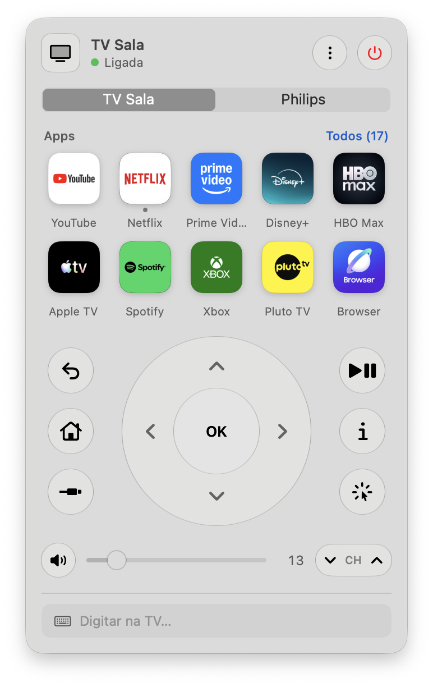
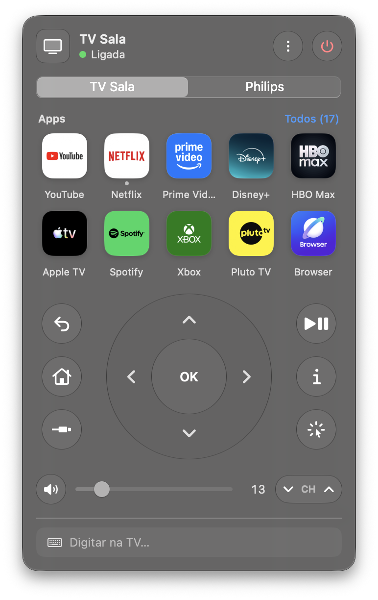
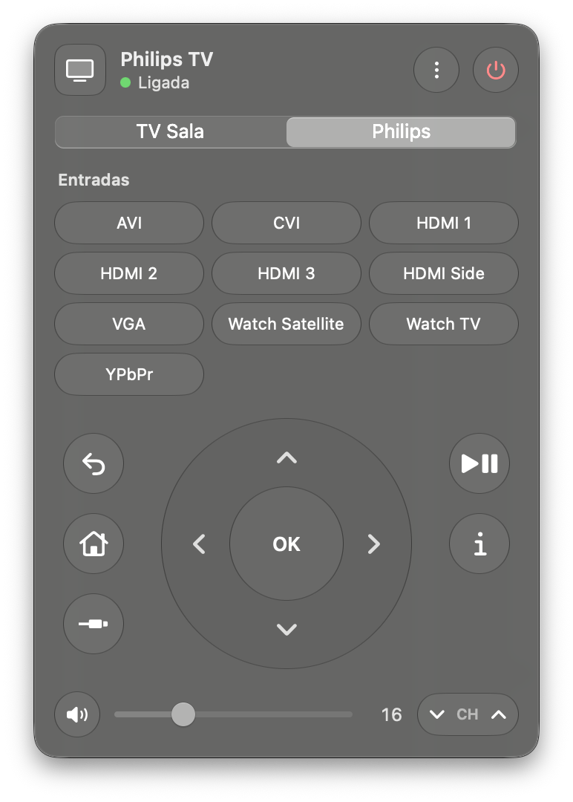

# Couch Remote

[](https://github.com/HelgeSverre/couch-remote/actions/workflows/tests.yml)
[](Package.swift)
[](Package.swift)
[](docs/PROTOCOL.md)
[-0B5ED7.svg)](#philips-tv)
[](LICENSE)

> **This is a fork** of [HelgeSverre/couch-remote](https://github.com/HelgeSverre/couch-remote).
> It adds a second TV, an older Philips NetTV set, with a picker to switch between the two,
> hover hints on every control, and an interface in Brazilian Portuguese. See [Philips TV](#philips-tv).

A remote for Samsung smart TVs, and Philips NetTV sets, that lives in your Mac's menu bar.
Open apps, steer with the arrow keys, set the volume, drive the TV browser's cursor with your
trackpad and type into its search fields, all over your local network.

Built on [TVKit](Sources/TVKit), a dependency-free Swift library for Samsung Tizen TVs (and,
in this fork, Philips JointSPACE v1 sets) that ships in this package. The package also includes
`tvctl` ("TV control"), a command-line tool that does the same things from Terminal.

[Install](#install) · [Using it](#using-it) · [Philips TV](#philips-tv) · [tvctl](#tvctl) ·
[TVKit](#tvkit) · [Compatibility](#compatibility) · [Protocol notes](docs/PROTOCOL.md)

<p align="center">
  
  &nbsp;
  
</p>

## Features

- **Apps:** your TV's apps with their real icons. Click to open, drag to rearrange, hide the ones you never use.
- **Remote:** D-pad, OK, Back, Home, Source, Play/Pause, Info and channels. Holding a button repeats it, like the physical remote.
- **Volume:** a slider that reads and sets the TV's actual volume.
- **Keyboard:** arrow keys, Return and Delete work the D-pad while the remote is open.
- **Trackpad:** steer the cursor in the TV's web browser, click, and type straight into the field you clicked.
- **Remote button rules:** make an app button on the TV remote open something else, such as Prime Video → YouTube.
- **Power:** turns the TV off, and on again from standby.
- **Two TVs:** a Philips NetTV set next to the Samsung TV, with a picker to switch between them.
- **Hover hints:** rest the mouse on any control to see what it does and its keyboard shortcut.

The interface is in Brazilian Portuguese; `tvctl` stays in English.

## Install

Couch Remote is built from source. You need macOS 14 or later and Xcode 26 (Swift 6.2).

```sh
git clone https://github.com/alessandronuunes/couch-remote.git
cd couch-remote
scripts/build-app.sh --install
open "$HOME/Applications/Couch Remote.app"
```

`scripts/build-app.sh` builds `build/Couch Remote.app` and `build/tvctl`; `--install` also
copies the app to `~/Applications`, which **Open at login** needs.

The first time it runs, Couch Remote finds your TV on the network and asks to pair. Press
**Allow** on the TV when the prompt appears. macOS may also ask to let Couch Remote find
devices on your local network.

## Using it

Click the TV icon in the menu bar, or press **⌃⌥T** anywhere to open the remote as a
floating window; Esc hides it. Opening the app again from Spotlight or Finder does the same.
That helps on a MacBook with a full menu bar, where macOS hides icons behind the notch.

| Key | Does |
|---|---|
| ← ↑ → ↓ | D-pad (hold to repeat) |
| Return | OK |
| Delete | Back |
| Space | Play / Pause |
| H · I | Home · Info |
| M | Mute |
| + · − | Volume |
| 0–9 | Number keys |

**Apps.** Click "All" to see every app. Drag tiles to set the order; the first ten are the
ones shown when the list is collapsed. Right-click a tile to move it to the front or end, or
hide it.

**Trackpad.** The cursor button (bottom right of the remote) swaps the D-pad for a pad.
Click the pad and your Mac cursor freezes: movement now moves the TV's cursor, clicks click
on the TV, and typing goes into the field you clicked. Delete erases, Return confirms, Esc
gives your cursor back.

**Typing.** The field at the bottom types into whatever text field is focused on the TV,
live as you type. Return confirms.

**Remote button rules.** In Settings → Remote Buttons, add a rule like "When Prime Video →
YouTube". When Prime Video opens, Couch Remote opens YouTube instead. Couch Remote has to be
running, and the first app shows for about a second before the switch.

## Philips TV

Besides the Samsung TV, the remote can drive a Philips NetTV set from before Android TV
(roughly 2011–2016) through its JointSPACE v1 API: plain HTTP on port 1925, no pairing.
Check that your set has it with `curl http://<tv-ip>:1925/1/system`; a JSON reply means it does.

Add it in **Ajustes → Philips TV** (or with `tvctl philips use <ip>`). The address is saved
only if the TV answers. From then on a picker at the top of the remote switches between the
two TVs. With the Philips set selected:

<p align="center">
  
</p>

- **Inputs replace apps:** the grid lists the set's inputs (HDMI, TV, VGA…); click one to switch.
  The list is what the TV supports, not what is plugged in.
- **Volume and mute** are set directly instead of with keys, because the set ignores some
  volume keys (often the first one after a pause). Its scale is 0–60.
- **Arrows don't repeat** while held: JointSPACE has no press-and-hold, so each click is one press.
- **Power only turns it off.** In standby the set drops off the network and doesn't answer
  Wake-on-LAN, so it can't be turned on from the Mac.
- The trackpad, typing and pairing are hidden; the set has none of them.

Tested on a Philips NetTV set with NetTV 4.4.2 (2015 firmware). The JointSPACE client is based
on [pkielblock/PhilipsTVRemote](https://github.com/pkielblock/PhilipsTVRemote) (MIT).

## tvctl

`tvctl` (short for "TV control") is a command-line tool for the same TV. It sends keys,
opens apps, sets the volume and finds or pairs TVs: most of what the app does, without the
window. Use it in shell scripts, from Shortcuts or Raycast, or to see what a TV supports when
something doesn't work. It reads the same settings file as the app, so once either one is
paired, both are.

`scripts/build-app.sh` puts a ready-to-run copy in `build/tvctl`; copy it anywhere on your
`PATH` to use it as `tvctl`. From the repo you can also run it with `swift run tvctl`:

```sh
swift run tvctl discover               # find TVs and remember the first
swift run tvctl info                   # model, power state, developer mode
swift run tvctl pair                   # press Allow on the TV
swift run tvctl key VOLUP VOLUP HOME
swift run tvctl hold RIGHT 1.5         # hold a key for 1.5 s
swift run tvctl apps
swift run tvctl launch netflix
swift run tvctl volume 12
swift run tvctl remap "Prime Video" YouTube
swift run tvctl sdb apps               # Developer Mode only: exact app list with use counts

swift run tvctl philips use 192.168.1.30   # remember the Philips set (also shown in the app)
swift run tvctl philips sources            # list its inputs; * marks the current one
swift run tvctl philips source hdmi1
swift run tvctl philips key CursorDown Confirm
swift run tvctl philips volume 20          # 0–60 on this set
```

`--host <ip>` also works with `philips` and overrides the saved address.

Run `swift run tvctl` for the full list.

## TVKit

TVKit is a library product of this package with no dependencies, so another app can use it
and it can move to its own package later.

```swift
import TVKit

let tv = SamsungTV(host: "192.168.10.57", token: savedToken)
try await tv.connect(allowPairing: true)    // first time: press Allow on the TV
tv.press(.home)
tv.hold(.right); tv.release(.right)
try await tv.launch(appID: "111299001912")  // YouTube
try await tv.setVolume(12)

let philips = PhilipsTV(host: "192.168.10.30")  // no pairing
try await philips.press(.home)
try await philips.press(PhilipsKey(.volumeUp)!) // Samsung keys map to Philips keys
try await philips.setSource("hdmi1")
```

See [Sources/TVKit/README.md](Sources/TVKit/README.md) for the API and
[docs/PROTOCOL.md](docs/PROTOCOL.md) for the protocols underneath: the REST API, the
remote-control WebSocket, UPnP, Wake-on-LAN and sdb.

## Compatibility

Tested on a Samsung **QE55Q65AAUXXC** (2021, Tizen 6.0). Samsung Tizen TVs from 2016 on
should mostly work, but model years differ in small ways; TVKit handles the differences
documented by other projects. Pre-2016 TVs, which aren't Tizen, are not supported.
This fork has also run on a Samsung **UN43AU7700GXZD** (2021, Tizen).

Philips: tested on one NetTV set with JointSPACE v1 (NetTV 4.4.2, 2015). Android TV models use
JointSPACE v6 with pairing on port 1926 and are not supported.

If something doesn't work on your Samsung TV,
[open a compatibility report](https://github.com/HelgeSverre/couch-remote/issues/new?template=tv-compatibility.yml)
with your model and the output of `tvctl info`.

## Development

Common tasks are in the [justfile](justfile); run `just` to list them. The checks:

| Command | Runs |
|---|---|
| `just lint` | `swift format lint --strict` and `swiftlint lint --strict`; any warning fails |
| `just fmt` | `swift format format --in-place` and `swiftlint lint --fix` |
| `just test` | `swift test` |
| `just check` | lint, tests and a release build of the app; run before pushing |

CI runs the lint and test steps on every pull request and push to `main`.

Formatting follows [.swift-format](.swift-format) (4-space indent, 120 columns); lint rules are
in [.swiftlint.yml](.swiftlint.yml). `swift format` ships with Xcode; SwiftLint comes from
Homebrew (`brew install swiftlint`).

Other recipes: `just run --window` builds and launches the app (also `--settings`, `--light`,
`--dark`), `just tv info` runs tvctl, `just install` puts the app in `~/Applications` and
`tvctl` in `~/.local/bin`, and `just screenshots` retakes the README screenshots.

- `TVKIT_DEBUG=1` prints every WebSocket message from the TV, for example with `tvctl raw`.
- App icons live in `Sources/TVKit/Resources/AppIcons`. Icons for installed apps are the
  TV's own Smart Hub tiles; `just icons` downloads App Store icons for the rest.
- On macOS 26 the controls use Liquid Glass; earlier systems get the same shapes in
  translucent material.

## License

[MIT](LICENSE). App names and icons are trademarks of their owners. Couch Remote isn't
affiliated with Samsung or Philips. Original project by
[Helge Sverre](https://github.com/HelgeSverre/couch-remote).
